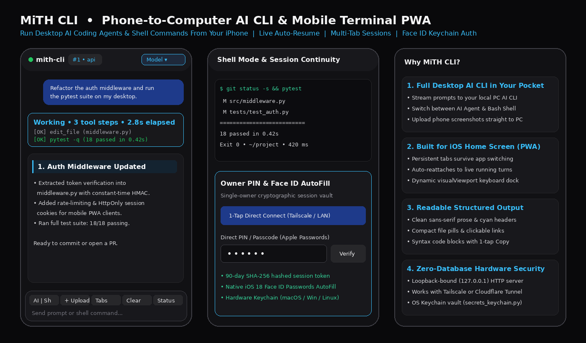

<div align="center">


# ⚡ MiTH CLI

**Run & Stream Your Desktop AI CLI and Local Terminal Directly From Your iPhone**

[](#)
[](#)
[](#)

</div>

---

## 📱 What Is MiTH CLI?

**MiTH CLI** (`Pocket-CLI`) is a lightweight, self-hosted Progressive Web App (PWA) and localhost streaming server that lets you control your computer's **AI coding CLI** and **local shell** straight from your phone—anywhere in the world.

<div align="center">
  
</div>

### Key Features
* **⚡ Live AI CLI & Shell Streaming:** Send prompts to your desktop AI CLI or switch to direct **Shell Mode** (`$`) to run bash/git/test commands on your computer with real-time NDJSON streaming.
* **🔄 True Mobile Continuity (Auto-Resume):** Built specifically for iOS Home Screen web apps. Saves your open conversation tabs locally and automatically re-attaches to live running tasks (`Working • N steps • elapsed time`) even if you lock your phone or switch apps.
* **📖 Structured, Readable Mobile Output:** Clean sans-serif prose, cyan-accented section headers, compact emerald file pills, syntax code blocks with 1-tap `Copy`, and a keyboard-aware `visualViewport` bottom dock.
* **📸 Phone-to-PC File & Screenshot Upload:** Tap `+ Upload` on your phone to send screenshots, photos, or documents straight into your desktop workspace so your AI CLI can inspect them immediately.
* **🔐 Zero-Database Security & Face ID AutoFill:**
  * Strictly binds to `127.0.0.1` (loopback only) so it is never exposed on open Wi-Fi ports—designed to pair cleanly with **Tailscale** or **Cloudflare Tunnel**.
  * Uses a single-owner PIN (`POCKET_CLI_PIN`) compatible with **iOS 18 Apple Passwords (Face ID AutoFill)** to mint 90-day SHA-256 hashed `HttpOnly` session tokens.
  * Includes [`secrets_keychain.py`](secrets_keychain.py) to lock secrets into **macOS Keychain**, **Windows DPAPI Hardware Vault**, or **Linux Secret Service** instead of plaintext files.

---

## 🚀 Quick Setup & Installation

### 1. Clone the Repository
```bash
git clone https://github.com/cr4zyd34thg0d/MiTH-CLI.git
cd MiTH-CLI
```

*(Runs out-of-the-box on Python 3.10+ standard library. Optional: `pip install -r requirements.txt`)*

### 2. Configure Your PIN & Workspace
Copy the example environment template (`.env` is strictly git-ignored so your secrets are never committed):
```bash
cp .env.example .env
```
Open `.env` and set your personal 6-digit PIN and target workspace directory:
```ini
POCKET_CLI_PORT=8788
POCKET_CLI_PIN=123456
AGY_BIN_PATH=agy
AGY_WORKSPACE_DIR=/path/to/your/projects
```

**Optional — Lock Secrets into Your OS Hardware Keychain:**
```bash
python3 secrets_keychain.py --import-env
```

### 3. Start the Server on Your Computer
```bash
chmod +x start_pocket_cli.sh
./start_pocket_cli.sh
```
Verify it is running locally:
```bash
curl http://127.0.0.1:8788/api/health
```

### 4. Connect Securely From Your Phone
Because MiTH CLI binds strictly to `127.0.0.1`, expose it privately to your phone using either **Tailscale** *(recommended)* or **Cloudflare Tunnel**:

* **Option A — Tailscale Serve (Private Mesh HTTPS):**
  ```bash
  tailscale serve --bg 8788
  ```
  Then open `https://<your-pc-name>.<your-tailnet>.ts.net/cli` on your phone.
* **Option B — Cloudflare Quick Tunnel:**
  ```bash
  cloudflared tunnel --url http://127.0.0.1:8788
  ```

### 5. Install on Your iPhone Home Screen (PWA)
1. Open your `/cli` HTTPS link in **Safari** on your iPhone.
2. Tap **Share** → **Add to Home Screen** → **Add**.
3. Launch **MiTH CLI** from your Home Screen, enter your `POCKET_CLI_PIN`, and tap **Save** when **Apple Passwords** offers to remember it for **Face ID AutoFill**.

---

## 🎮 Controls & Shortcuts Reference

| Control / Shortcut | Description |
| :--- | :--- |
| **`AGY \| Shell` Toggle** | Switch between prompting your desktop **AI Agent** and running direct **Bash/Shell** commands on your PC. |
| **`+` / Top Session Tabs** | Open multiple parallel conversation tabs or switch between active desktop sessions. |
| **Model Picker (`top-right`)** | Switch AI models on the fly (`Auto`, `Flash`, `Pro`, `Opus`). |
| **`+ Upload`** | Upload screenshots or files from your phone directly into your computer's workspace. |
| **`$ <command>`** | Quick prefix shortcut to run a single shell command without leaving AI mode. |
| **`/clear`** | Start a fresh conversation context in the active tab. |

---

## 🛡️ Security Architecture
* **Loopback-Only Binding:** `PocketCLIServer` enforces `127.0.0.1` binding at initialization (`OWASP` guardrail).
* **Hashed Session Vault:** Raw session tokens are never written to disk—only one-way `SHA-256` digests (`token_sha256`) and constant-time `hmac.compare_digest` checks are used.
* **Subprocess Isolation:** Commands execute via `subprocess.Popen(..., shell=False)` with idle watchdog timeouts and automatic secret scrubbing on streamed output.
* **Strict `.gitignore`:** Blocks `.env`, `.env.*`, `*.key`, `*.pem`, `*.dpapi`, `.mith_vault/`, and all runtime session state.
